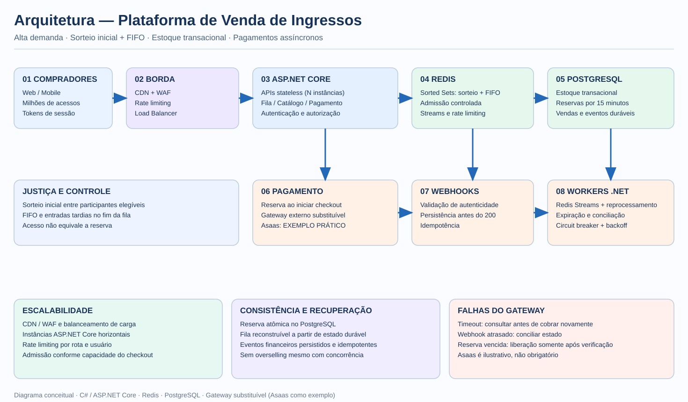

# Desafio BigDataCorp — Arquitetura de Venda de Ingressos

> Proposta conceitual de arquitetura para uma plataforma de venda de ingressos de alta demanda. Este repositório documenta decisões de projeto; **não representa um sistema implementado, testado ou implantado**.

## Diagrama



[Visualizar o diagrama em tamanho completo](docs/arquitetura-ingressos.svg)

## Problema e objetivos

Em uma abertura de vendas para um evento com oferta limitada, um grande número de usuários tenta comprar simultaneamente. A solução deve: (1) absorver picos de tráfego; (2) impedir a venda de ingressos acima do estoque; (3) reduzir vantagens decorrentes da velocidade da conexão; e (4) tolerar falhas e atrasos no processamento dos pagamentos.

## Decisões de arquitetura

| Responsabilidade | Solução proposta |
| --- | --- |
| Entrada e proteção | CDN, WAF, load balancer e rate limiting por rota/usuário |
| Serviços HTTP | C# / ASP.NET Core, instâncias stateless com escalabilidade horizontal |
| Justiça e espera | Sorteio inicial de posições, seguido de FIFO; Redis Sorted Sets |
| Controle de acesso | Admissão gradual por lotes conforme a capacidade de compra |
| Estoque oficial | PostgreSQL, transações e atualização condicional/bloqueio concorrente |
| Reserva | Criada **ao iniciar o pagamento**, com duração inicial de 15 minutos |
| Eventos e tarefas | Redis Streams e .NET Worker Services; eventos críticos persistidos no PostgreSQL |
| Pagamento | API de um provedor externo, webhooks e conciliação assíncrona |
| Resiliência | Idempotência, circuit breaker, retry com backoff, observabilidade e recuperação |

### 1. Justiça: sorteio inicial + FIFO

Uma janela de participação é aberta antes da venda. Os participantes elegíveis recebem uma posição aleatória no encerramento dessa janela; depois, a ordem é preservada por FIFO. Quem chega após o sorteio entra **depois dos participantes já posicionados**, sem furar a fila. Tokens assinados e controles de sessão evitam perda de posição por reconexão e dificultam múltiplas entradas abusivas.

A admissão ocorre em lotes e não por uma corrida de requisições. A autorização para acessar o catálogo é diferente de reservar um ingresso. O sistema deve considerar limites por pessoa, prevenção a bots e regras claras para usuários que não utilizem sua autorização no prazo.

### 2. Escalabilidade e controle de picos

CDN/WAF absorvem parte do tráfego e mitigam abusos; o load balancer distribui as requisições entre múltiplas instâncias ASP.NET Core. Rate limiting por rota/usuário protege os endpoints. A fila virtual desacopla o número de interessados da capacidade do checkout: **apenas um número controlado de usuários é admitido**, ajustado por latência, erros, conexões ao banco e taxa de conclusão.

Escalar APIs não elimina limites do PostgreSQL, Redis ou provedor de pagamentos. A admissão precisa respeitar esses gargalos. Métricas e alertas devem cobrir latência p95, throughput, tamanho da fila, reservas pendentes e falhas externas.

### 3. Seleção, reserva e consistência

Na seleção, o ingresso **ainda não está reservado**. Ao avançar para o pagamento, o serviço executa uma operação transacional no PostgreSQL para verificar disponibilidade e criar a reserva com `expires_at` de 15 minutos. Duas tentativas concorrentes pelo último ingresso não podem ser ambas confirmadas. Uma transação atômica e restrições de integridade são necessárias, independentemente da fila Redis.

Estados conceituais: `AVAILABLE` → `RESERVED` → `SOLD`; reservas podem passar por `EXPIRED` ou `PENDING_RECONCILIATION`. A expiração não deve liberar um ingresso cuja cobrança tenha resultado desconhecido até que a conciliação estabeleça o estado seguro.

### 4. Gateway de pagamento e processamento assíncrono

**O Asaas é apenas um exemplo de gateway**, escolhido com base na **minha experiência prática com integrações de API, assinaturas e webhooks dessa plataforma**. **Não é uma exigência do desafio nem uma dependência arquitetural obrigatória.** O serviço de pagamento deve ser abstraído por uma interface para permitir substituição por outro provedor.

Fluxo proposto:
1. A API cria a reserva transacional e registra a intenção de pagamento.
2. Uma integração com o provedor cria/consulta a cobrança com identificação correlacionável e proteção contra duplicidade.
3. O endpoint recebe o webhook, valida sua autenticidade e persiste o evento de maneira durável **antes** de confirmar o recebimento.
4. Um worker .NET consome os eventos e atualiza o pagamento e a venda de forma idempotente.
5. Se o webhook atrasar ou se perder, uma rotina de conciliação consulta o estado da cobrança.

**Falhas do provedor:** circuit breaker para indisponibilidade, timeouts e retries com backoff para falhas transitórias. Em timeout com resultado desconhecido, consultar/reconciliar antes de criar nova cobrança. Reservas vencidas só retornam ao estoque depois de uma verificação segura do pagamento; pendências não podem bloquear o estoque indefinidamente e exigem política operacional de cancelamento/conciliação.

### 5. Recuperação de falhas

Redis acelera fila, sessões e eventos, mas não é a fonte oficial das vendas. A ordem de prioridade deve possuir **registro durável suficiente para reconstrução** em caso de perda do Redis; guardar apenas algumas posições anteriores não é suficiente. Eventos financeiros críticos ficam registrados no PostgreSQL (padrões inbox/outbox podem ser empregados) para reprocessamento seguro. Workers devem suportar entregas duplicadas e execução repetida.

### 6. Segurança e observabilidade

Autenticação e autorização, tokens de fila assinados, limites por usuário, validação de webhooks, gestão segura de segredos, logs estruturados, métricas, tracing (OpenTelemetry), auditoria e alertas operacionais. Dados de pagamento sensíveis não devem ser armazenados indevidamente na aplicação.

## Fluxo resumido

```text
Usuário → CDN/WAF → Load Balancer → ASP.NET Core
                                       ├─ Redis: sorteio, FIFO, admissão, rate limiting
                                       ├─ PostgreSQL: estoque, reservas, vendas e eventos
                                       └─ Gateway (ex.: Asaas): cobrança e webhooks
                                               ↓
                                         .NET Workers
                                               ↓
                                    Conciliação e atualização
                                               ↓
                                          PostgreSQL
```

## Limitações e próximos passos

O desenho é uma **proposta de alto nível**. Em implementação real, seriam necessários testes de carga e concorrência, simulações de queda do Redis e do provedor, políticas antifraude, validação de prazos de pagamento por modalidade, recuperação de fila, definição de SLOs e provas de que o estoque nunca fica negativo.

## Tecnologias propostas

C# · ASP.NET Core · Redis · PostgreSQL · .NET Worker Services · OpenTelemetry · Gateway de pagamento substituível (Asaas como exemplo).

---
**Escopo:** estudo de arquitetura para avaliação técnica, sem implementação funcional.
